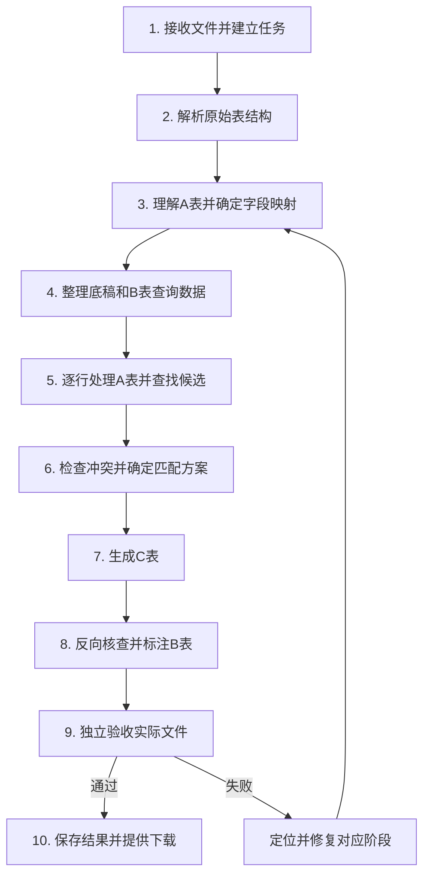

# 财务对账 Agent 整体流程

日期：2026-10-31。状态：实现规划，描述目标行为。

本文保留从后端收到文件到最终交付的完整流程。详细实现拆分为三块，按顺序交接数据；三块是职责划分，不要求部署为三个服务或三个独立 Agent。

| 分块 | 对应完整流程 | 详细文档 |
| --- | --- | --- |
| 第一块：数据接入与底稿准备 | 第 1—4 步 | [01-数据接入与底稿准备](./01-数据接入与底稿准备.md) |
| 第二块：逐行匹配与复核 | 第 5—6 步 | [02-逐行匹配与复核](./02-逐行匹配与复核.md) |
| 第三块：制表、反向核查与交付 | 第 7—10 步 | [03-制表反向核查与交付](./03-制表反向核查与交付.md) |

## 1. 业务依据与适用范围

业务依据：

- [财务对账表制表逻辑通用指南](../提示词实现文档/财务对账表制表逻辑通用指南.md)。
- [财务对账表C表制作与反向核查强制规则](../提示词实现文档/财务对账表C表制作与反向核查强制规则.md)。

本方案首先落实文档中具体的 A/B/C 出入库对账流程。银行流水、发票、应收应付等场景可复用任务和核查机制，但需要各自的字段适配和匹配规则，不能直接套用入库 K—M、出库 N—P。

具体 C 表业务以强制规则为验收约束。通用指南中的“七月”、固定列号、连续两三行等案例不能写成通用上限或固定月份。

## 2. 输入与输出

### 2.1 输入

| 输入 | 是否必需 | 含义 |
| --- | --- | --- |
| A 表 | 是 | 业务侧对账底稿，决定 C 表原始业务内容、顺序和基本版式 |
| B 表 | 是 | 系统出入库明细，提供匹配证据和追溯数据 |
| 对账年月 | 是 | 例如 `2026-07`，决定 B 表反向核查的期间 |
| 任务配置 | 按需 | 工作表范围、字段映射、日期容差、名称映射等 |
| 人工参考及确认 | 按需 | 人工调整表、候选确认、排除原因及复核结论 |

对账年月可以由文件内容提出建议，但最终必须成为明确的任务参数。期间不明确时进入待确认状态。

### 2.2 输出

1. **C 表**：完整继承 A 表，追加匹配状态、依据和 B 表追溯字段。
2. **标注后的 B 表副本**：保留系统原始数据，对当月未承接、人工排除等情况给出标注。
3. **核查报告**：提供验收结果、覆盖情况、差异及待复核事项。核查报告是本方案对强制核查结果的产品化输出。

输入原文件保留，所有加工结果写入任务的新版本产物。

## 3. 完整流程



图中修复分支表示可回到相应阶段，并非所有失败都必须重跑字段识别。

| 步骤 | 处理内容 | 主要执行者 | 阶段产物 |
| --- | --- | --- | --- |
| 1. 接收与建任务 | 保存文件、检查可读性、记录月份和配置 | 程序 | 任务上下文、文件清单 |
| 2. 原始解析 | 读取工作表、原始值、公式、样式、合并区域及来源位置 | 程序 | 原始记录、表结构摘要 |
| 3. 字段识别 | 确定表头、明细、合计和字段对应关系 | 程序；陌生结构由模型辅助 | 已验证字段映射 |
| 4. 数据准备 | 复制 A 底稿、整理日期和明细、建立 B 查询索引 | 程序 | 准备完成的数据包 |
| 5. A 行处理 | 按原始顺序查询、计算候选；必要时分析语义 | 程序；疑难处调用模型 | 行处理记录、候选关系 |
| 6. 关系确认 | 处理竞争候选、重复使用、分组及人工复核 | 程序、模型及必要的人工 | 已校验匹配方案 |
| 7. C 表生成 | 承接 B 原始字段、展开明细、修正合计和显示 | 程序 | 待验收 C 表 |
| 8. B 反向核查 | 检查当月系统记录去向，追加缺失等标注 | 程序 | 标注 B 副本、覆盖明细 |
| 9. 独立验收 | 重读实际文件，核查 A 口径、B 覆盖、公式、精度和视图 | 程序；Agent 组织修复 | 核查报告 |
| 10. 结果交付 | 保存版本，提供统计、文件下载和结果说明 | 程序；模型可辅助说明 | 最终交付包 |

## 4. Agent 与程序的职责

Agent 负责流程调度、陌生表结构理解、规格语义分析、疑点解释和修复步骤选择。模型接收必要的表结构摘要、当前 A 行上下文及候选证据，返回结构化建议。

程序负责文件读写、数值计算、候选检索、规则校验、记录使用检查、制表及验收。每条 A 明细均进入同一工作流，严格规则能处理的记录直接由程序完成。

人工处理机器无法确定的业务关系、必要的字段确认和业务排除。人工排除必须有记录对象、确认人、原因和时间。

模型不能改写来源数值、虚构系统记录、越过验收失败，或把证据不足的候选直接升级为确定匹配。

## 5. 三块之间传递什么

```text
后端输入
  → 第一块：PreparedData
  → 第二块：MatchPlan
  → 第三块：DeliveryResult
```

| 数据对象 | 定义位置 | 主要内容 |
| --- | --- | --- |
| `TaskContext` | 第一块 | 任务、文件、月份、配置、规则和版本 |
| `PreparedData` | 第一块 | 字段映射、A 明细、B 业务记录、C 底稿、原始值和来源引用 |
| `MatchPlan` | 第二块 | A 行处理结果、匹配组、分配关系、复核事项、排除记录 |
| `DeliveryResult` | 第三块 | 文件清单、验收报告、统计及交付状态 |

文件和大量数据保存在任务存储中，交接对象传递版本与引用；模型调用只取当前问题所需的证据。各对象使用统一的任务编号、来源标识、十进制数值表达和规则版本。

## 6. 全流程必须保持的约束

1. C 表从 A 表完整复制而来，A 原始业务顺序和数值保持可追溯。
2. 先遍历原始 A 明细列表，保存匹配关系，最后统一展开 C 表；插行不能改变遍历对象。
3. 正数匹配入库，负数匹配出库；零数量、零金额及补发件不自动忽略。
4. 多行组合包含非连续记录，不能仅支持连续两三行。
5. 保留原始精度，标准化值与原始值分开保存。
6. B 来源记录保持独立身份，内容相同的两行不自动去重；共享记录必须有明确的分配关系。
7. 每条 B 当月业务记录必须已承接、已标注缺失或已人工排除。
8. 验收重读实际文件，不能只相信匹配计划和生成日志。
9. A/C 原始业务数量及金额差额为零；公式错误数量为零。

## 7. 任务状态与恢复

建议状态为：`received → preparing → matching → rendering → reverse_checking → verifying → completed / completed_with_review`。

- `needs_input`：缺少必要参数、字段映射或关键业务确认；保存暂停阶段和待确认问题，收到答案后续跑。
- `repairing`：核查发现可修复问题；按配置限制自动修复次数。
- `failed`：文件不可处理、工具失败且重试耗尽，或验收问题未能解决；保存错误和诊断产物。
- `completed_with_review`：技术及数据完整性验收通过，但仍有如实列明的业务差异或待复核事项。
- `completed`：验收通过，且没有待复核事项。存在已说明的未匹配业务时，结果说明仍必须明确列示。

行处理进度保存已处理 A 原始记录标识；重试同一行不能重复添加匹配或重复消耗 B 记录。字段映射、规则或人工确认变化后，增加数据版本，并重新执行受影响的下游步骤。

业务未匹配与程序执行失败分开记录。单纯“找不到对应 B 记录”可形成未匹配业务结果；读取失败、候选搜索未完成等不能伪装成业务未匹配。

## 8. 实施顺序与最终验收

按第一块、第二块、第三块依次实施，每块先通过自身验收，再联调交接对象。具体函数名、存储介质和接口路径可以在实现时确定，但不能改变交接对象的含义。

最终联调应覆盖：严格单行、一对多非连续、负数退货、日期/规格复核、零金额补发、重复内容的 B 行、竞争候选、人工排除、公式缓存缺失、插行合计、原始精度和任务续跑。

已有前端的演示比对只可作为界面演示；真实任务必须经过上述数据准备、匹配、反向核查和独立验收，才能获得交付状态。
